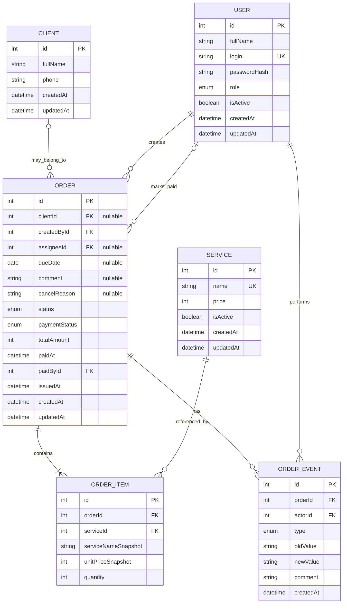
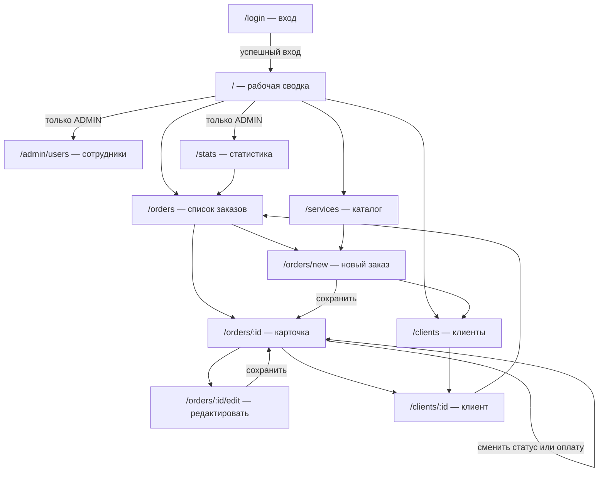
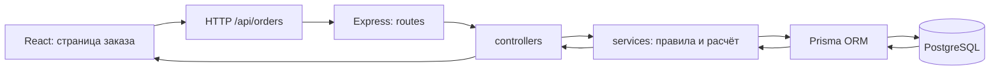

# Архитектура: информационная система учёта заказов мастерской ключей

> **Тема дипломной работы:** «Разработка информационной системы учета заказов мастерской ключей»  
> **Рабочее название:** «КлючУчёт» (можно переименовать без изменения архитектуры)  
> **Стек:** React (Vite) + HTML + CSS + JavaScript + Node.js + Express + PostgreSQL + Prisma ORM  
> **Назначение документа:** проектирование системы **до написания исходного кода**.  
> **Статус:** согласованное функциональное ядро + явно обозначенные проектные решения.

---

## 0. О проекте и границах требований

### Что делает система

Веб-приложение помогает мастерской по изготовлению и дублированию ключей вести учёт клиентов, услуг и заказов. Сотрудник может выбрать клиента **или создать быстрый заказ без карточки клиента**, добавить одну или несколько услуг с количеством; сервер рассчитывает стоимость. Заказ проходит этапы выполнения; руководитель видит заказы, сотрудников и статистику.

**Для кого:** для **администратора** и **сотрудника мастерской**. Клиент не авторизуется: его имя и телефон вносит сотрудник.

**Какую проблему решает:** заменяет разрозненные бумажные записи, позволяет быстро найти заказ и его состояние, уменьшает ошибки в расчёте, сохраняет историю обращений и показывает результаты работы мастерской.

### Подтверждённые требования

| Вопрос | Согласованный ответ |
|---|---|
| Роли | Администратор и сотрудник |
| Услуги | Дубликаты обычных ключей; автомобильные ключи; ремонт ключей; программирование домофонных ключей |
| Расчёт | Фиксированная цена конкретной услуги × количество |
| Статусы | Сотрудник меняет статусы; администратор контролирует |
| Клиенты | Имя, телефон, история заказов; быстрый заказ допускается без карточки клиента |
| Оплата | Только отметка «Оплачен / Не оплачен»; выдача разрешена лишь после оплаты |
| Статистика | Количество заказов, общая выручка, количество заказов по статусам |
| Технологии | React + Vite, Node.js + Express, PostgreSQL, Prisma |

### Мои проектные решения

Для первой версии я выбрал следующие решения. Они задают границы MVP и порядок работы системы:

1. **Одна мастерская** в первой версии, без филиалов и интернет-заказов.
2. **Одна валюта — тенге (KZT)**; все цены и суммы хранятся **целыми тенге**, без тиынов.
3. Заказ может включать **несколько услуг**; повторные позиции одной услуги объединяются по количеству.
4. Никаких скидок, индивидуальных цен, авансов, частичных платежей и возвратов денег в MVP.
5. Статусы заказа: `NEW`, `IN_PROGRESS`, `READY`, `ISSUED`, `CANCELLED`. Предложенная схема переходов описана в разделе 4.
6. Правки услуг и количества разрешены **до готовности и до отметки оплаты**. Это предохраняет историю от незаметного изменения стоимости.
7. Под «выручкой» в MVP понимаем **сумму заказов, отмеченных оплаченными**, по времени отметки оплаты. Это управленческий показатель, **не бухгалтерский или фискальный учёт**.
8. Начальные цены четырёх видов услуг заполняет администратор; **конкретные цены не придумываются в архитектуре**.
9. **Быстрый заказ** создаётся без карточки клиента: `clientId = null`, никаких обязательных имени и телефона. При желании сотрудник может позже привязать клиента до оплаты, пока редактирование заказа разрешено.
10. **Выдача готового заказа только после отметки оплаты `PAID`**. Если клиент платит при получении, сотрудник сначала отмечает оплату и лишь затем нажимает «Выдать».
11. Авторизация через **JWT в заголовке `Authorization: Bearer <token>`**, без cookie. Дополнительное поле для контроля номера версии заказа не требуется.

**Почему так:** эти ограничения удерживают объём диплома в разумных пределах, но не мешают впоследствии добавить сложные функции. Все решения, зависящие от реального регламента мастерской, явно выделены как предложения.

### Главный рабочий сценарий

1. Сотрудник входит в систему.
2. Выбирает существующего клиента, заводит его карточку либо нажимает «Быстрый заказ» без карточки клиента.
3. Создаёт заказ: выбирает услуги и количество, без ручного ввода итоговой цены.
4. Сервер сохраняет цены выбранных услуг **на момент заказа** и рассчитывает итог.
5. Сотрудник переводит заказ через рабочие статусы.
6. При получении оплаты отмечает заказ как оплаченный.
7. **Только после оплаты** переводит готовый заказ в `ISSUED` («Выдан»).
8. Администратор видит количество заказов, их состояния и выручку.

**Почему так:** это один законченный процесс, который легко продемонстрировать на защите — от обращения клиента до готового заказа и статистики.

---

## 1. Пользователи и роли

| Роль | Кто это | Может делать | Не может делать |
|---|---|---|---|
| **Гость** | Неавторизованный посетитель | Открыть `/login`, войти | Читать данные клиентов, заказы, сотрудников |
| **Сотрудник** (`EMPLOYEE`) | Приёмщик или мастер | Создавать и находить клиентов; создавать и редактировать разрешённые заказы; менять статусы; отмечать оплату; смотреть каталог и историю | Менять цены каталога; управлять пользователями; просматривать финансовую статистику; снимать ошибочную отметку оплаты без администратора |
| **Администратор** (`ADMIN`) | Руководитель мастерской | Все действия сотрудника; добавлять/отключать сотрудников; управлять каталогом и ценами; просматривать статистику; исправлять ошибочную отметку оплаты с записью события | Удалять без следа исторические заказы и оплаченные позиции |

**Почему так:** двух ролей достаточно: сотрудник занимается заказами, администратор — настройками и контролем. Третья роль «мастер» в первой версии не нужна, поскольку отдельные полномочия мастера не подтверждены.

**Почему нет роли клиента:** личный кабинет потребовал бы регистрации клиентов, восстановления доступа и защиты отдельного внешнего интерфейса, хотя согласован только внутренний учёт.

**Начальное создание пользователей:** первый администратор создаётся однократным локальным скриптом заполнения базы (`seed`); открытой регистрации нет. После этого новых сотрудников создаёт только администратор.

---

## 2. MVP — первая работающая версия

### Восемь обязательных функциональных блоков

| № | Блок MVP | Что должно работать при демонстрации |
|---|---|---|
| 1 | Вход и роли | Логин/пароль, JWT в заголовке Bearer, выход на клиенте, закрытые страницы и права ролей |
| 2 | Сотрудники | Администратор создаёт сотрудника, меняет данные и отключает доступ |
| 3 | Клиенты | Добавление и изменение имени/телефона, поиск и история заказов; возможность оформить заказ без клиента |
| 4 | Каталог услуг | Четыре начальных вида услуг; администратор устанавливает цену, редактирует и отключает услугу |
| 5 | Заказы и расчёт | Обычный и быстрый заказ (без карточки клиента), позиции, автоматическая стоимость в целых тенге и цена-снимок |
| 6 | Выполнение заказов | Просмотр, допустимое редактирование, смена статусов, запрет выдачи без оплаты, журнал событий |
| 7 | Оплата и поиск | Отметка оплаты, списки заказов с фильтрами, поиском и карточкой заказа |
| 8 | Статистика | Общее число заказов, сумма оплаченных заказов, распределение по статусам за выбранный период |

### После основной версии

- Учёт заготовок и расходных материалов.
- Уведомление клиента о статусе «Готов».
- Экспорт ведомостей заказов и выручки в CSV/PDF.

### Что не нужно в MVP

| Функция | Причина исключения |
|---|---|
| Личный кабинет клиента | Не согласован; усложняет авторизацию и персональные данные |
| Интернет-заказ и онлайн-оплата | Потребует внешних платёжных сервисов и дополнительного процесса |
| Фискальные чеки, возвраты и частичные платежи | Это отдельная финансовая предметная область; согласована лишь двоичная отметка оплаты |
| Склад заготовок | Полезен, но не нужен для основной задачи учёта заказов |
| Несколько филиалов | Пока не подтверждены, не добавляем лишние сущности |
| Скидки и произвольная цена заказа | Противоречат простому согласованному правилу «цена × количество» |
| Загрузка файлов и фотографий | Потребует отдельного хранения и контроля файлов |
| Сложные графики и PDF-отчёты | Таблица и несколько числовых показателей уже достаточны для дипломной демонстрации |

**Почему так:** система остаётся полноценной благодаря разным ролям, связанной базе, серверным правилам, журналу истории и статистике, но объём реализации остаётся подъёмным для студента третьего курса.

---

## 3. Пользовательские истории

Формат: «Как [роль], я хочу [действие], чтобы [цель]». ✅ — MVP, ⏳ — расширение.

| ID | Роль | История | MVP |
|---|---|---|---|
| `US-01` | Сотрудник/администратор | Как пользователь системы, я хочу войти по логину и паролю, чтобы работать со своими разрешёнными функциями. | ✅ |
| `US-02` | Администратор | Как администратор, я хочу создавать и отключать сотрудников, чтобы управлять доступом к системе. | ✅ |
| `US-03` | Сотрудник | Как сотрудник, я хочу добавлять и изменять данные клиентов, чтобы быстро оформлять их обращения. | ✅ |
| `US-04` | Администратор | Как администратор, я хочу менять цены и доступность услуг, чтобы каталог оставался актуальным. | ✅ |
| `US-05` | Сотрудник | Как сотрудник, я хочу создать обычный или быстрый заказ с услугами и количеством, чтобы зарегистрировать работу даже без карточки клиента. | ✅ |
| `US-06` | Сотрудник | Как сотрудник, я хочу видеть рассчитанную системой стоимость, чтобы не ошибиться в сумме. | ✅ |
| `US-07` | Сотрудник | Как сотрудник, я хочу искать и фильтровать заказы, чтобы быстро находить нужные. | ✅ |
| `US-08` | Сотрудник | Как сотрудник, я хочу открывать карточку заказа, чтобы видеть услуги, сумму, состояние и клиента, если он указан. | ✅ |
| `US-09` | Сотрудник | Как сотрудник, я хочу исправить позиции неоплаченного незавершённого заказа, чтобы устранить ошибку при приёме. | ✅ |
| `US-10` | Сотрудник | Как сотрудник, я хочу менять статус заказа и выдавать его только после оплаты, чтобы не отдавать неоплаченный заказ. | ✅ |
| `US-11` | Администратор | Как администратор, я хочу видеть журнал изменений заказа, чтобы знать, кто и когда менял статус или оплату. | ✅ |
| `US-12` | Сотрудник | Как сотрудник, я хочу отмечать заказ оплаченным, чтобы руководитель видел оплаченные работы. | ✅ |
| `US-13` | Администратор | Как администратор, я хочу видеть количество заказов, выручку и статусы за период, чтобы контролировать работу мастерской. | ✅ |
| `US-14` | Администратор | Как администратор, я хочу учитывать заготовки ключей, чтобы знать остатки материалов. | ⏳ |
| `US-15` | Сотрудник | Как сотрудник, я хочу уведомлять клиента о готовом заказе, чтобы ускорить выдачу. | ⏳ |
| `US-16` | Сотрудник | Как сотрудник, я хочу оформить переделку по готовому или выданному заказу, чтобы бесплатно исправить работу, не меняя старый заказ. | ✅ |

**Почему так:** истории имеют ID, поэтому можно связать каждый API-запрос и страницу с конкретной задачей, а затем проверять готовность диплома по списку, а не «на глаз».

---

## 4. Бизнес-правила и жизненный цикл заказа

**Главный принцип:** браузер показывает подсказки, но **решения принимает сервер**. Пользователь может обойти HTML-форму и вручную отправить запрос с поддельной ценой, статусом или ролью.

### 4.1. Статусы заказа

| Статус в БД | Подпись в интерфейсе | Значение |
|---|---|---|
| `NEW` | Новый | Заказ зарегистрирован, работа ещё не начата |
| `IN_PROGRESS` | В работе | Услуги выполняются |
| `READY` | Готов | Работа закончена, заказ ожидает выдачи |
| `ISSUED` | Выдан | Клиент получил заказ; окончательный статус |
| `CANCELLED` | Отменён | Заказ отменён без оплаты; окончательный статус |

**Предлагаемая последовательность для MVP** (включая отмену неоплаченного заказа):

```mermaid
stateDiagram-v2
    [*] --> NEW: заказ зарегистрирован
    NEW --> IN_PROGRESS: начать работу
    IN_PROGRESS --> READY: работа выполнена
    READY --> ISSUED: клиент забрал; только PAID
    NEW --> CANCELLED: отменить
    IN_PROGRESS --> CANCELLED: отменить
    READY --> CANCELLED: отменить (только ADMIN, с причиной)
    ISSUED --> [*]
    CANCELLED --> [*]
```



`ISSUED` **всегда означает**, что заказ уже был помечен как `PAID` перед выдачей. Статус выполнения и отметка оплаты хранятся отдельно: например, готовый заказ может оставаться `UNPAID`, но **выдавать его нельзя**. В MVP нет возвратов денег и отмены уже оплаченных заказов. Исправление ошибочной отметки оплаты после выдачи тоже запрещено — это потребовало бы отдельного процесса возврата/корректировки.

**Почему так:** если совместить оплату и готовность в одном статусе («готов и оплачен», «готов и не оплачен»), количество комбинаций быстро вырастет, а фильтры и переходы усложнятся. Отдельные поля понятнее и надёжнее.

### 4.2. Правила, обязательные на сервере

| Код | Правило | Почему браузерной проверки недостаточно |
|---|---|---|
| `BR-01` | Доступ к API получают только действующие (`isActive=true`) авторизованные пользователи. | У отключённого сотрудника может сохраниться старый токен. |
| `BR-02` | Администратор управляет сотрудниками, каталогом, статистикой; сотрудник — рабочими заказами и клиентами. | Скрытые кнопки не запрещают прямой запрос к API. |
| `BR-03` | У клиента обязательны непустое имя и телефон. Перед сохранением и поиском сервер приводит номер к формату `+7XXXXXXXXXX`: например, `8 701 123-45-67` → `+77011234567`. Номер, который нельзя привести к этому формату, отклоняется. | В базе и поиске используется единый формат телефона. |
| `BR-04` | У заказа **минимум одна позиция**; `clientId` можно не передавать или передать `null` для быстрого заказа; дополнительных полей имени/телефона при этом не требуется. Если `clientId` указан, такой клиент должен существовать. | Иначе прямым запросом можно отправить пустой заказ либо ссылку на несуществующего клиента. |
| `BR-05` | В каждой позиции `quantity` — целое число больше нуля; одна услуга в заказе встречается только один раз. | Иначе итог будет неверным и появятся неоднозначные дубликаты. |
| `BR-06` | Новую позицию можно добавить только по существующей **активной** услуге каталога. | Иначе можно оформить несуществующую или отключённую услугу. |
| `BR-07` | Цена каталога — **целое неотрицательное число тенге (`Int`)**, задаёт её только администратор; суммы и количество должны помещаться в допустимый диапазон PostgreSQL `integer`. | Подделанный запрос может установить отрицательную/дробную цену или слишком большое число. |
| `BR-08` | **Сервер** берёт цену из `Service`, рассчитывает `unitPriceSnapshot × quantity` и сумму всех позиций; итог из браузера не принимается. Исключение — переделка по `BR-25`: сервер сам создаёт позиции с нулевой ценой. | Пользователь не может подменить стоимость обычного заказа; бесплатная переделка оформляется отдельно. |
| `BR-09` | При создании/редактировании заказа сервер сохраняет название и цену каждой услуги как снимок. Изменение каталога позже не меняет старый заказ. | Если старые заказы читать по сегодняшней цене, история и выручка исказятся. |
| `BR-10` | Редактировать клиента и состав заказа разрешено лишь в статусах `NEW` и `IN_PROGRESS`, **пока заказ не оплачен**. | Иначе оплаченная/выданная работа незаметно изменит сумму. |
| `BR-11` | Статус меняется только по диаграмме; переход `READY → ISSUED` разрешён **исключительно при `paymentStatus=PAID`**; `ISSUED` и `CANCELLED` конечные. | Иначе сотрудник может выдать заказ без оплаты или вернуть выданный заказ в работу. |
| `BR-12` | Отменять можно только **неоплаченный** заказ. Для `READY → CANCELLED` дополнительно действуют `BR-26`: только администратор и с обязательной причиной. Оплаченные отмены и возвраты — за пределами MVP. | Иначе отчёт покажет деньги за отменённую работу без логики возврата. |
| `BR-13` | Отметить `PAID` у неотменённого и ещё не выданного заказа могут обе роли. Исправить `PAID → UNPAID` может только администратор и **только до выдачи**, с записью в журнал. | Иначе выданный заказ неожиданно станет неоплаченным и нарушит `BR-11`. |
| `BR-14` | Отметка оплаты сама не меняет рабочий статус заказа; **но переход в `ISSUED` зависит от оплаты**. | Нужно отдельно отразить факт работы и факт оплаты, не допуская неоплаченной выдачи. |
| `BR-15` | Дату регистрации, дату оплаты, дату выдачи и автора изменений фиксирует **сервер**, а не форма. | Клиент может подменить дату или выдать себя за другого сотрудника. |
| `BR-16` | Создание/правка заказа, обновление суммы и запись события происходят **в одной транзакции** (всё вместе либо ничего). | Иначе после ошибки в базе может сохраниться сумма без позиций или статус без истории. |
| `BR-17` | Для смены статуса/оплаты сервер проверяет текущее состояние и выполняет **условное атомарное обновление в транзакции**; при неподходящем состоянии возвращает `409`. Для одновременных правок состава заказа **версионного контроля в MVP нет**. | Проверка только при открытии формы устаревает. При одновременной работе возможна перезапись правок состава — это известное ограничение первой версии. |
| `BR-18` | Исторические заказы и события не удаляются через интерфейс; услуга/сотрудник отключаются флагом `isActive`. | Иначе исчезнут старые обращения, отчёты и сведения об авторе. |
| `BR-19` | Нельзя отключить последнего активного администратора или собственную текущую учётную запись администратора. | Иначе никто не сможет управлять системой. |
| `BR-20` | Выручка за период = сумма `totalAmount` заказов, **сейчас имеющих `PAID`**, у которых `paidAt` внутри периода. Количество заказов и статусы считаются по дате создания. | Иначе можно ошибочно посчитать неоплаченные заказы доходом или смешать разные временные критерии. |
| `BR-21` | Для статистики период задаётся по местным календарным дням мастерской; границы преобразуются в UTC для запроса к БД. | Иначе заказ около полуночи попадёт не в тот день. |
| `BR-22` | Даты, статус, оплату, цену и доступность услуги сервер проверяет непосредственно при записи, в транзакции. | Между открытием формы и сохранением другой сотрудник мог изменить данные. |
| `BR-23` | `dueDate` — необязательный срок готовности. Если срок указан и текущая дата мастерской позже даты `dueDate`, а заказ ещё не `ISSUED`/`CANCELLED`, интерфейс отмечает заказ как просроченный. | Сотрудник сразу видит заказы, срок которых прошёл. |
| `BR-24` | `assigneeId` — необязательный исполнитель заказа (ссылка на активного сотрудника). `createdById` остаётся автором оформления и не заменяет исполнителя. Если мастер в мастерской один, исполнителя можно не указывать. | Видно, кто принял заказ и кто отвечает за выполнение. |
| `BR-25` | Переделка оформляется отдельным новым заказом с `totalAmount=0`, нулевой ценой позиций и комментарием `Переделка по заказу №…`. Оформить её можно по заказу в статусе `READY` или `ISSUED`; оплата нового заказа сразу `PAID`, так как сумма равна 0. Исходный заказ не изменяется. | Сохраняется история первоначального заказа и бесплатной переделки. |
| `BR-26` | Отменить заказ из `READY` может только `ADMIN`; причина отмены обязательна и сохраняется в событии журнала. Заказы в `NEW` и `IN_PROGRESS` отменяются сотрудником или администратором по обычным правилам. | Готовая работа и потраченная заготовка не списываются без контроля администратора. |

**Правило быстрого заказа:** `clientId=null` — полностью корректное значение. Заказ без карточки клиента участвует в списке, статусах, журнале и статистике. Интерфейс показывает «Без карточки клиента», а не выдумывает имя или телефон. Поиск по данным клиента для него недоступен, пока сотрудник не привяжет клиента.

**Срок и исполнитель:** `dueDate` можно не указывать; это только дата (`дд.мм.гггг`), время не хранится. Если он задан, просрочка определяется на сервере по текущей дате и отображается в списке заказов. `assigneeId` также необязателен: это сотрудник, который выполняет работу; `createdById` хранит того, кто оформил заказ.

**Переделка:** если изготовленный ключ не подошёл, исходный заказ не переписывается. Сотрудник создаёт новый заказ с нулевой стоимостью и комментарием `Переделка по заказу №…`. Это сохраняет обе записи в истории.

**Отмена готового заказа:** заказ в `READY` может отменить только администратор и только с указанием причины. Причина записывается в журнал событий.

**Оговорка о корректировке оплаты:** исправление ошибочной отметки `PAID → UNPAID` попадает в `OrderEvent`, а `paidAt` очищается. При повторной отметке ставится новое время оплаты. Поэтому отчёт MVP показывает **текущее состояние данных**, а не неизменяемый бухгалтерский реестр. Настоящий возврат денег, кассовая книга и строгий финансовый аудит потребуют отдельной платёжной модели в будущем.

**Почему так:** это честная граница модели с двоичным признаком оплаты; архитектура не выдаёт простую отметку за полноценную бухгалтерию.

### 4.3. Расчёт стоимости: пример

Пример **только для объяснения алгоритма**, не прайс мастерской:

| Услуга | Цена на момент заказа | Количество | Сумма позиции |
|---|---:|---:|---:|
| Дубликат обычного ключа | 800 ₸ | 2 | 1 600 ₸ |
| Программирование домофонного ключа | 1 500 ₸ | 1 | 1 500 ₸ |
| **Итого** | | | **3 100 ₸** |

Если завтра администратор меняет цену первого вида услуги на 900 ₸, в этом заказе по-прежнему сохраняется **800 ₸ за единицу** и итог **3 100 ₸**.

**Почему так:** цена в каталоге — актуальная для будущих заказов; цена позиции заказа — зафиксированная договорённость на момент оформления.

---

## 5. База данных PostgreSQL + Prisma ORM

### 5.1. Сущности и типы

Обозначения: **PK** — первичный ключ (ID строки), **FK** — внешний ключ (ссылка на строку другой таблицы), **UK** — уникальное значение, `?` — необязательное поле. Типы даны в терминологии Prisma и PostgreSQL; таблицы далее названы в единственном числе как модели Prisma.

#### `User` — пользователи системы

| Поле | Тип | Обяз. | Ключ | Назначение |
|---|---|---|---|---|
| `id` | `Int` (integer) | Да | PK | ID сотрудника |
| `fullName` | `String` (text) | Да | — | ФИО |
| `login` | `String` (text) | Да | UK | Логин для входа |
| `passwordHash` | `String` (text) | Да | — | Хеш пароля, **не пароль** |
| `role` | `Role` (enum) | Да | — | `ADMIN` / `EMPLOYEE` |
| `isActive` | `Boolean` (boolean) | Да | — | Имеет ли право работать |
| `createdAt` | `DateTime` (timestamp with time zone) | Да | — | Когда создан |
| `updatedAt` | `DateTime` (timestamp with time zone) | Да | — | Последнее изменение |

#### `Client` — клиенты

| Поле | Тип | Обяз. | Ключ | Назначение |
|---|---|---|---|---|
| `id` | `Int` | Да | PK | ID клиента |
| `fullName` | `String` | Да | — | Имя клиента |
| `phone` | `String` | Да | индекс | Телефон для поиска и связи |
| `createdAt` | `DateTime` | Да | — | Когда добавлен |
| `updatedAt` | `DateTime` | Да | — | Когда изменён |

Телефон **не уникален**: им могут пользоваться несколько людей (например, члены семьи). Сервер удаляет пробелы, скобки и дефисы; принимает номер с `+7`, `7` или `8` в начале и приводит его к виду `+7XXXXXXXXXX`. Например, `8 701 123-45-67` сохраняется как `+77011234567`. После нормализации проверяется, что осталось ровно 10 цифр после кода страны. При вводе сотруднику можно показывать найденные совпадения, но не объединять клиентов автоматически.

#### `Service` — каталог услуг

| Поле | Тип | Обяз. | Ключ | Назначение |
|---|---|---|---|---|
| `id` | `Int` | Да | PK | ID услуги |
| `name` | `String` | Да | UK | Наименование услуги |
| `price` | `Int` (`integer`) | Да | — | Текущая цена услуги в целых KZT |
| `isActive` | `Boolean` | Да | — | Доступна ли для новых заказов |
| `createdAt` | `DateTime` | Да | — | Дата создания |
| `updatedAt` | `DateTime` | Да | — | Последняя правка |

Четыре согласованных вида услуг — **начальные записи справочника**, а не четыре отдельные таблицы. Новую услугу администратор может добавить через каталог, не меняя архитектуру.

#### `Order` — заказ

| Поле | Тип | Обяз. | Ключ | Назначение |
|---|---|---|---|---|
| `id` | `Int` | Да | PK | Номер заказа, например `№ 105` |
| `clientId` | `Int?` | Нет | FK → `Client.id`, `NULL` разрешён | Карточка клиента, если она оформлена; `null` — быстрый заказ |
| `createdById` | `Int` | Да | FK → `User.id` | Кто оформил заказ |
| `assigneeId` | `Int?` | Нет | FK → `User.id` | Кто выполняет работу; может быть `null` |
| `dueDate` | `Date?` (`@db.Date`) | Нет | индекс | Плановый срок готовности, только дата без времени |
| `comment` | `String?` | Нет | — | Комментарий к заказу, в том числе причина/ссылка на переделку |
| `status` | `OrderStatus` (enum) | Да | индекс | `NEW`, `IN_PROGRESS`, `READY`, `ISSUED`, `CANCELLED` |
| `paymentStatus` | `PaymentStatus` (enum) | Да | индекс | `UNPAID` / `PAID` |
| `totalAmount` | `Int` (`integer`) | Да | — | Итог в целых KZT, рассчитанный сервером |
| `paidAt` | `DateTime?` | Нет | индекс | Время отметки оплаты; нет у неоплаченного |
| `paidById` | `Int?` | Нет | FK → `User.id` | Кто отметил оплату |
| `issuedAt` | `DateTime?` | Нет | — | Когда заказ выдан |
| `cancelReason` | `String?` | Нет | — | Причина отмены заказа из `READY`; обязательна для этого перехода |
| `createdAt` | `DateTime` | Да | индекс | Время регистрации |
| `updatedAt` | `DateTime` | Да | — | Последнее изменение |

Начальные значения: `status=NEW`, `paymentStatus=UNPAID`, `totalAmount=0` **только внутри транзакции создания** до расчёта, `paidAt=null`, `paidById=null`, `issuedAt=null`, `assigneeId=null`, `dueDate=null`. Запись с нулевой предварительной суммой не должна становиться видимой как завершённое создание заказа.

#### `OrderItem` — позиции заказа

| Поле | Тип | Обяз. | Ключ | Назначение |
|---|---|---|---|---|
| `id` | `Int` | Да | PK | ID позиции |
| `orderId` | `Int` | Да | FK → `Order.id` | Какому заказу принадлежит |
| `serviceId` | `Int` | Да | FK → `Service.id` | Ссылка на услугу каталога |
| `serviceNameSnapshot` | `String` | Да | — | Название **на момент оформления** |
| `unitPriceSnapshot` | `Int` (`integer`) | Да | — | Цена в целых тенге **на момент оформления** |
| `quantity` | `Int` | Да | — | Положительное целое число |

**Уникальная пара:** (`orderId`, `serviceId`) — одна услуга не повторяется в пределах заказа. `lineTotal` в БД **не хранится**: его можно точно вычислить как `unitPriceSnapshot × quantity`.

При редактировании заказа существующие неизменённые позиции сохраняют свои снимки цен; **для заново добавленной услуги** берётся текущая цена каталога. Изменение количества существующей позиции использует ранее зафиксированную цену. Отключение услуги в каталоге не уничтожает позиции уже созданных заказов.

#### `OrderEvent` — журнал событий заказа

| Поле | Тип | Обяз. | Ключ | Назначение |
|---|---|---|---|---|
| `id` | `Int` | Да | PK | ID события |
| `orderId` | `Int` | Да | FK → `Order.id` | К какому заказу относится |
| `actorId` | `Int` | Да | FK → `User.id` | Кто выполнил действие |
| `type` | `OrderEventType` (enum) | Да | — | `CREATED`, `ORDER_UPDATED`, `STATUS_CHANGED`, `PAYMENT_CHANGED` |
| `oldValue` | `String?` | Нет | — | Предыдущее значение (для статуса/оплаты) |
| `newValue` | `String?` | Нет | — | Новое значение (для статуса/оплаты) |
| `comment` | `String?` | Нет | — | Короткая поясняющая запись |
| `createdAt` | `DateTime` | Да | индекс | Серверное время события |

События добавляются **только** системой; изменять и удалять их через API нельзя. Для `ORDER_UPDATED` событие сообщает факт изменения, **но не хранит старый полный список позиций**. Если понадобится строгая история каждой правки количества/цены, расширим модель детализированными снимками или отдельной таблицей изменений.

**Почему так:** журнал объясняет, кто перевёл заказ в «Готов» или отметил оплату, но не перегружает MVP полноценным аудиторским движком.

**Почему отдельной таблицы `Payment` нет:** подтверждена только отметка «Оплачен / Не оплачен», без суммы платежа, способа, частичной оплаты и возврата. Для такой модели достаточно `Order.paymentStatus`, `paidAt`, `paidById` и события в `OrderEvent`. Реальные платежи при расширении следует хранить отдельно.

**Почему отдельной таблицы статусов нет:** значения `OrderStatus` и `PaymentStatus` фиксированы и немногочисленны; enum (заранее заданный перечень) проще, чем таблица-справочник, пока редактирование статусов не требуется.

### 5.2. Связи между таблицами

| Связь | Тип | Объяснение |
|---|---|---|
| `Client → Order` | 1:N, необязательная связь со стороны заказа | У клиента много заказов; у быстрого заказа клиента может не быть |
| `User → Order (createdById)` | 1:N | Сотрудник оформляет много заказов |
| `User → Order (assigneeId)` | 1:N | Сотрудник может выполнять много заказов; поле исполнителя необязательное |
| `User → Order (paidById)` | 1:N (необязательная ссылка со стороны заказа) | Кто отметил оплату |
| `Order → OrderItem` | 1:N | В заказе одна или несколько позиций |
| `Service → OrderItem` | 1:N | Услуга встречается в разных заказах |
| `Order ↔ Service` | M:N **через `OrderItem`** | Заказ содержит много услуг, услуга встречается во многих заказах |
| `Order → OrderEvent` | 1:N | У заказа много событий |
| `User → OrderEvent` | 1:N | Сотрудник создаёт много событий |
| 1:1 | **Нет** | Отдельная связь «один к одному» бизнесом не требуется |

**Почему так:** отдельные таблицы клиента, услуги, заказа и позиции устраняют повторение одних и тех же данных. `OrderItem` одновременно хранит детали связи «многие ко многим».

### 5.3. ER-диаграмма



> На схеме показана предметная структура; фактические `onDelete`-правила, индексы и уникальные ограничения описаны ниже и реализуются в схеме Prisma/миграциях. `Order` содержит минимум одну позицию — это правило сервиса в транзакции; обычный FK сам по себе не гарантирует такую минимальную кратность.

### 5.4. Ограничения и целостность

- `User.login` и `Service.name` уникальны; (`OrderItem.orderId`, `OrderItem.serviceId`) — составной уникальный индекс.
- `Client.phone`, `Order.createdAt`, (`Order.status`, `Order.createdAt`), (`Order.paymentStatus`, `Order.paidAt`), `Order.clientId`, (`OrderEvent.orderId`, `OrderEvent.createdAt`) — полезные индексы поиска.
- Обязательные поля имеют `NOT NULL`; все FK должны ссылаться на реальные строки.
- Удалять пользователя, услугу и клиента, на которых ссылается история, **не нужно**: используем запрет удаления (`RESTRICT`) и отключение там, где оно предусмотрено.
- Наличие минимум одной позиции, `quantity > 0`, `price >= 0`, согласованность `paidAt/paidById` и допустимые переходы проверяются в сервисе; устойчивые числовые ограничения можно дополнительно закрепить SQL `CHECK` в миграции PostgreSQL.
- Статус, оплата и история меняются согласованно через транзакцию Prisma; для статусных операций используется условное обновление по текущим полям.
- Для внешних ключей `paidById` и временных полей применяется `NULL`, когда заказ не оплачен/не выдан.

**Почему так:** сервер защищает бизнес-правила, а ограничения самой базы страхуют от случайных ошибок программирования и сохраняют связи.

### 5.5. Дублирование, история и цены

1. **Нет ненужного повторения:** телефон и имя оформленного клиента хранятся в `Client`, каталог — в `Service`; заказ ссылается на `Client.id` только при наличии карточки.
2. **Нужное историческое дублирование:** `serviceNameSnapshot` и `unitPriceSnapshot` намеренно копируются в позицию заказа. Без этого переименование услуги или обновление прайса переписывало бы прошлое.
3. **Осознанное итоговое поле:** `Order.totalAmount` можно пересчитать по позициям. Оно сохранено для быстрого списка и статистики, но **обновляется только сервисом заказов** вместе с позициями в одной транзакции.
4. **Текущий статус + события:** `Order.status` нужен для быстрых фильтров, `OrderEvent` — чтобы видеть последовательность действий и автора; обе записи обновляются согласованно.
5. **История обращений клиента:** список всех `Order`, связанных с `Client.id`. Быстрые заказы без клиента отображаются в общем списке и могут быть привязаны к клиенту позже, пока заказ можно редактировать.
6. **Изменение контактного имени:** в исторических заказах будет отображаться актуальное имя клиента. Если потребуется фиксировать имя именно на дату приёма, можно добавить `clientNameSnapshot`, но это **пока не согласованное требование**.

**Почему так:** дублирование допустимо там, где оно защищает исторические договорённости или упрощает важные запросы, если изменение производится в одном контролируемом месте.

### 5.6. Как безопасно хранить суммы и даты

- Для цены и итога используется PostgreSQL `integer` / Prisma `Int`: **целые тенге** без тиынов. Числа проще для учебной задачи и не создают погрешности дробных вычислений.
- В JSON денежные значения передаются как **числа**, например `3100` (не строки и не дробные числа).
- Сервер не принимает дроби, отрицательные цены, значения выше `2 147 483 647` и суммарные результаты вне диапазона `integer`; проверяет переполнение **до записи** в PostgreSQL.
- Все временные отметки пишутся сервером и хранятся как моменты времени (PostgreSQL `timestamptz` / Prisma `DateTime` с явным сопоставлением типа).
- Для интерфейса мастерской дата отображается в `Asia/Almaty`, а фильтры локальных календарных дней преобразуются в границы UTC.
- Для учебной версии `Int`-идентификатор заказа является его номером. Дополнительную таблицу нумерации заводить не нужно.

### 5.7. Как модель расширяется

Новые модули (материалы, уведомления, выгрузки) добавляются отдельными таблицами или API поверх существующих `Order`/`Client`/`Service`. Для уведомлений заказ без карточки клиента сначала необходимо связать с клиентом и его телефоном. При необходимости новые необязательные поля вводятся миграциями, старые заказы остаются корректными. **Одна мастерская** не требует отдельной таблицы филиалов в первой версии.

**Почему так:** проектирование «на десять лет вперёд» добавило бы сложность сейчас без реальной пользы. Миграции Prisma позволяют развивать структуру последовательно.

---
## 6. API — взаимодействие React и Express

**API** (интерфейс обмена данными) позволяет браузеру обращаться к серверу по HTTP. Все пути ниже начинаются с `/api`; тела запросов и ответов — **JSON**. Сервер **никогда** не отдаёт `passwordHash`. При успешном входе сервер возвращает **JWT в JSON**; React отправляет его в заголовке `Authorization: Bearer <token>` на каждом защищённом запросе. Cookie для авторизации **не используется**.

Обозначения доступа: **Г** — гость, **С** — сотрудник (`EMPLOYEE`), **А** — администратор (`ADMIN`), **Оба** — С и А.

### 6.1. Полная таблица эндпоинтов MVP

| Метод | URL | Назначение | Роль | История |
|---|---|---|---|---|
| `POST` | `/api/auth/login` | Войти | Г | US-01 |
| `GET` | `/api/auth/me` | Узнать текущего пользователя | Оба | US-01 |
| `GET` | `/api/users` | Список сотрудников | А | US-02 |
| `POST` | `/api/users` | Создать сотрудника | А | US-02 |
| `PATCH` | `/api/users/:id` | Изменить сотрудника, роль, пароль или доступ | А | US-02 |
| `GET` | `/api/clients` | Поиск/список клиентов | Оба | US-03 |
| `POST` | `/api/clients` | Добавить клиента | Оба | US-03 |
| `GET` | `/api/clients/:id` | Карточка клиента | Оба | US-03, US-08 |
| `PATCH` | `/api/clients/:id` | Изменить контактные данные | Оба | US-03 |
| `GET` | `/api/services` | Список услуг с ценами | Оба | US-04, US-05 |
| `POST` | `/api/services` | Создать услугу | А | US-04 |
| `PATCH` | `/api/services/:id` | Обновить цену/название/активность | А | US-04 |
| `GET` | `/api/orders` | Список, поиск и фильтры | Оба | US-07 |
| `POST` | `/api/orders` | Создать заказ, рассчитать сумму | Оба | US-05, US-06 |
| `GET` | `/api/orders/:id` | Карточка заказа | Оба | US-08 |
| `PATCH` | `/api/orders/:id` | Исправить состав/клиента допустимого заказа | Оба | US-09 |
| `POST` | `/api/orders/:id/status` | Перевести заказ в следующий разрешённый статус | Оба | US-10 |
| `POST` | `/api/orders/:id/rework` | Оформить переделку отдельным заказом | Оба | US-16 |
| `POST` | `/api/orders/:id/payment` | Отметить оплату/разрешённое исправление | С, А* | US-12 |
| `GET` | `/api/orders/:id/events` | История действий с заказом | Оба | US-11 |
| `GET` | `/api/stats/overview` | Количество заказов, выручка, разбивка по статусам | А | US-13 |

\* `UNPAID → PAID`: С или А; `PAID → UNPAID`: только А. Проверка определяется **текущим состоянием заказа**, а не только методом маршрута.

**Почему так:** общие CRUD-действия (создать/посмотреть/изменить) выделены отдельно, а важные бизнес-действия — **специальными URL** `/status` и `/payment`. Нельзя одним общим `PATCH /orders/:id` произвольно переписать статус, оплату и рассчитанную сумму в обход сервиса.

### 6.2. Правила API

- `GET` только читает; `POST` создаёт ресурс/выполняет действие; `PATCH` изменяет разрешённые поля.
- Данные и роли проверяются **на сервере**. `createdById`, `actorId`, `paidAt`, `issuedAt`, `totalAmount`, `cancelReason` и снимки цен нельзя передавать из браузера как доверенные поля. `assigneeId` и `dueDate` принимаются только после серверной проверки. `Service.price` меняет только администратор.
- Для списков доступны `page`, `pageSize`; допустим, по умолчанию 20 записей, максимум 100. Ответ: `items`, `total`, `page`, `pageSize`.
- `GET /orders` принимает `search`, `status`, `paymentStatus`, `clientId`, `dateFrom`, `dateTo`, `page`, `pageSize`.
- `GET /services` по умолчанию отдаёт активные; `includeInactive=true` разрешён только администратору.
- `GET /stats/overview` принимает `from=YYYY-MM-DD`, `to=YYYY-MM-DD` (включительно по местному календарю).
- Все защищённые запросы, кроме входа, содержат `Authorization: Bearer <token>`. Смена статуса и оплаты повторно проверяет текущие поля заказа на сервере; отдельный номер версии не передаётся.
- Цена и сумма в JSON представлены **целыми числами** (`800`), количество — положительным целым числом.
- Ошибки возвращаются единообразно: `{"error":{"code":"...","message":"..."}}`.

| HTTP | Когда применяется |
|---|---|
| `200 OK` | Успешный просмотр или изменение |
| `201 Created` | Создание записи |
| `400 Bad Request` | Ошибочный формат, пустое имя, недопустимое количество |
| `401 Unauthorized` | Нет действительного входа |
| `403 Forbidden` | Вошёл, но роль не имеет права на действие |
| `404 Not Found` | Запись отсутствует |
| `409 Conflict` | Повтор логина, запрещённый переход, попытка выдать неоплаченный заказ, изменение уже оплаченного заказа, переделка не по готовому/выданному заказу |
| `429 Too Many Requests` | Слишком много попыток входа |
| `500 Internal Server Error` | Непредвиденная ошибка; детали скрыты от клиента |

**Почему так:** единая форма ошибок позволяет React показать понятное сообщение для любого запроса, а предсказуемые коды облегчают тестирование и защиту.

### 6.3. Примеры запроса и ответа **для каждого эндпоинта**

В примерах используются вымышленные пользователи, суммы и даты. Они показывают формат обмена данными и не являются прайсом мастерской. Для `GET` тело запроса отсутствует. Во всех примерах, кроме `POST /api/auth/login`, предполагается заголовок `Authorization: Bearer <token>`; он не повторяется в каждом примере. Все JSON-блоки — примеры **данных API**, а не исходный код приложения.

#### Авторизация

**1) `POST /api/auth/login`** — US-01, гость.

Запрос:

```json
{"login":"worker1","password":"ExamplePassword123!"}
```

Ответ `200` (JWT возвращается в JSON; все остальные запросы требуют заголовок `Authorization: Bearer <token>`):

```json
{"token":"<jwt-token>","tokenType":"Bearer","expiresIn":28800,"user":{"id":2,"fullName":"Сотрудник мастерской","login":"worker1","role":"EMPLOYEE"}}
```

**2) `GET /api/auth/me`** — US-01, оба. Запрос: `GET /api/auth/me` с заголовком `Authorization: Bearer <token>`, без тела. Ответ `200`:

```json
{"user":{"id":2,"fullName":"Сотрудник мастерской","login":"worker1","role":"EMPLOYEE"}}
```

#### Сотрудники

**3) `GET /api/users`** — US-02, А. Запрос: `GET /api/users?page=1` (тело отсутствует). Ответ `200`:

```json
{"items":[{"id":1,"fullName":"Администратор","login":"admin","role":"ADMIN","isActive":true},{"id":2,"fullName":"Сотрудник мастерской","login":"worker1","role":"EMPLOYEE","isActive":true}],"total":2,"page":1,"pageSize":20}
```

**4) `POST /api/users`** — US-02, А. Запрос:

```json
{"fullName":"Новый сотрудник","login":"worker2","password":"ExamplePassword456!","role":"EMPLOYEE"}
```

Ответ `201`:

```json
{"id":3,"fullName":"Новый сотрудник","login":"worker2","role":"EMPLOYEE","isActive":true}
```

**5) `PATCH /api/users/3`** — US-02, А. Запрос (например, отключение):

```json
{"isActive":false}
```

Ответ `200`:

```json
{"id":3,"fullName":"Новый сотрудник","login":"worker2","role":"EMPLOYEE","isActive":false}
```

При смене пароля поле запроса называется `password`, но в ответе пароль отсутствует. Отключение последнего администратора даст `409`.

#### Клиенты

**6) `GET /api/clients`** — US-03, оба. Запрос: `GET /api/clients?search=7701&page=1`. Ответ `200`:

```json
{"items":[{"id":12,"fullName":"Клиент А.","phone":"+77011234567"}],"total":1,"page":1,"pageSize":20}
```

**7) `POST /api/clients`** — US-03, оба. Запрос:

```json
{"fullName":"Клиент А.","phone":"8 701 123-45-67"}
```

Ответ `201`:

```json
{"id":12,"fullName":"Клиент А.","phone":"+77011234567"}
```

**8) `GET /api/clients/12`** — US-03, US-08, оба. Запрос: без тела. Ответ `200`:

```json
{"id":12,"fullName":"Клиент А.","phone":"+77011234567","ordersCount":3,"latestOrders":[{"id":105,"status":"NEW","totalAmount":3100}]}
```

Полная история доступна через `GET /api/orders?clientId=12`, поэтому отдельный второй эндпоинт истории клиента не нужен.

**9) `PATCH /api/clients/12`** — US-03, оба. Запрос:

```json
{"fullName":"Клиент А.","phone":"+77017654321"}
```

Ответ `200`:

```json
{"id":12,"fullName":"Клиент А.","phone":"+77017654321"}
```

#### Каталог услуг

**10) `GET /api/services`** — US-04, US-05, оба. Запрос: `GET /api/services` (без тела). Ответ `200`:

```json
{"items":[{"id":1,"name":"Изготовление дубликата обычного ключа","price":800,"isActive":true},{"id":4,"name":"Программирование домофонного ключа","price":1500,"isActive":true}]}
```

В примере показана часть каталога; в реальном начальном справочнике будут четыре согласованных вида услуг.

**11) `POST /api/services`** — US-04, А. Запрос:

```json
{"name":"Ремонт корпуса автомобильного ключа","price":2500}
```

Ответ `201`:

```json
{"id":5,"name":"Ремонт корпуса автомобильного ключа","price":2500,"isActive":true}
```

**12) `PATCH /api/services/1`** — US-04, А. Запрос (пример изменения прайса):

```json
{"price":900}
```

Ответ `200`:

```json
{"id":1,"name":"Изготовление дубликата обычного ключа","price":900,"isActive":true}
```

**Важно:** ранее созданный заказ № 105 всё равно хранит `unitPriceSnapshot=800`.

#### Заказы

**13) `GET /api/orders`** — US-07, оба. Запрос: `GET /api/orders?status=NEW&search=105&page=1`. Ответ `200`:

```json
{"items":[{"id":105,"client":{"id":12,"fullName":"Клиент А."},"status":"NEW","paymentStatus":"UNPAID","totalAmount":3100,"createdAt":"2026-11-17T09:30:00Z"}],"total":1,"page":1,"pageSize":20}
```

**14) `POST /api/orders`** — US-05, US-06, оба. Запрос: **без цены и без итога**:

```json
{"clientId":12,"assigneeId":2,"dueDate":"2026-11-20","comment":null,"items":[{"serviceId":1,"quantity":2},{"serviceId":4,"quantity":1}]}
```

Ответ `201`:

```json
{"id":105,"clientId":12,"createdById":2,"assigneeId":2,"dueDate":"2026-11-20","status":"NEW","paymentStatus":"UNPAID","totalAmount":3100,"items":[{"id":501,"serviceId":1,"serviceNameSnapshot":"Изготовление дубликата обычного ключа","unitPriceSnapshot":800,"quantity":2,"lineTotal":1600},{"id":502,"serviceId":4,"serviceNameSnapshot":"Программирование домофонного ключа","unitPriceSnapshot":1500,"quantity":1,"lineTotal":1500}]}
```

Для **быстрого заказа** используем тот же `POST /api/orders`, но **без `clientId`** (или с `"clientId":null`):

```json
{"items":[{"serviceId":1,"quantity":1}]}
```

Ответ: `{"id":106,"clientId":null,"status":"NEW","paymentStatus":"UNPAID","totalAmount":800}` (поля позиций опущены ради краткости).

`lineTotal` в ответе вычислено сервером; столбца `lineTotal` в БД нет. Значения цены в этом ответе соответствуют **моменту создания**, даже если позже каталог был изменён.

**15) `GET /api/orders/105`** — US-08, оба. Запрос: без тела. Ответ `200` (сокращённая карточка; у быстрого заказа вместо объекта клиента приходит `"client":null`):

```json
{"id":105,"client":{"id":12,"fullName":"Клиент А.","phone":"+77011234567"},"createdBy":{"id":2,"fullName":"Сотрудник мастерской"},"status":"NEW","paymentStatus":"UNPAID","totalAmount":3100,"createdAt":"2026-11-17T09:30:00Z","items":[{"id":501,"serviceId":1,"serviceNameSnapshot":"Изготовление дубликата обычного ключа","unitPriceSnapshot":800,"quantity":2,"lineTotal":1600},{"id":502,"serviceId":4,"serviceNameSnapshot":"Программирование домофонного ключа","unitPriceSnapshot":1500,"quantity":1,"lineTotal":1500}]}
```

**16) `PATCH /api/orders/105`** — US-09, оба. Запрос (заказ пока `NEW` и `UNPAID`):

```json
{"clientId":12,"items":[{"serviceId":1,"quantity":3},{"serviceId":4,"quantity":1}]}
```

Ответ `200`:

```json
{"id":105,"status":"NEW","paymentStatus":"UNPAID","totalAmount":3900}
```

Цена существующей позиции № 1 остаётся **800 ₸** за штуку; сервер пересчитал 3 × 800 + 1 × 1500. При одновременных правках позиции могут перезаписываться: версии заказа в MVP нет, после сохранения карточка загружается заново.

**17) `POST /api/orders/105/status`** — US-10, оба. Запрос (после предыдущего примера):

```json
{"status":"IN_PROGRESS"}
```

Ответ `200`:

```json
{"id":105,"status":"IN_PROGRESS","changedAt":"2026-11-17T10:30:00Z"}
```

Ошибка `409` при попытке перепрыгнуть сразу из `NEW` в `ISSUED`:

```json
{"error":{"code":"INVALID_STATUS_TRANSITION","message":"Нельзя перевести заказ из NEW в ISSUED"}}
```

**Отмена готового заказа:** `POST /api/orders/105/status` с телом `{"status":"CANCELLED","reason":"Клиент отказался от заказа"}`. Запрос доступен только администратору; без причины сервер возвращает `400`, сотруднику — `403`. Причина сохраняется в `Order.cancelReason` и `OrderEvent.comment`.

**18) `POST /api/orders/105/rework`** — US-16, оба. Запрос (заказ № 105 в статусе `READY`; причина необязательна):

```json
{"reason":"Ключ не подошёл к замку, нужно подточить"}
```

Ответ `201`:

```json
{"id":106,"status":"NEW","paymentStatus":"PAID","totalAmount":0,"comment":"Переделка по заказу № 105: Ключ не подошёл к замку, нужно подточить"}
```

Сервер копирует позиции заказа № 105, ставит каждой `unitPriceSnapshot=0` и `totalAmount=0` (BR-08, BR-25). Новый заказ создаётся со статусом `NEW` и тем же клиентом, срок и исполнитель не заполняются. Платить нечего, поэтому оплата сразу `PAID`, и такой заказ можно выдать без отдельной отметки; выручка не меняется, так как сумма равна 0. Исходный заказ № 105 не изменяется, в его историю добавляется запись о переделке № 106. Если причина не указана, комментарий будет `Переделка по заказу № 105`.

Ошибки: `404`, если заказа нет; `409` с кодом `REWORK_NOT_ALLOWED`, если исходный заказ не в статусе `READY` или `ISSUED` (в `NEW`, `IN_PROGRESS` и `CANCELLED` переделывать нечего):

```json
{"error":{"code":"REWORK_NOT_ALLOWED","message":"Переделку можно оформить только по готовому или выданному заказу"}}
```


**19) `POST /api/orders/105/payment`** — US-12, С/А. Запрос (заказ в работе):

```json
{"paymentStatus":"PAID"}
```

Ответ `200`:

```json
{"id":105,"paymentStatus":"PAID","paidAt":"2026-11-17T11:15:00Z","paidById":2}
```

Администратор может отправить `"paymentStatus":"UNPAID"` **только если заказ не выдан**; сотруднику сервер ответит `403`. При этом журнал сохраняет событие исправления.

**Проверка выдачи:** даже у заказа в `READY` запрос `POST /api/orders/105/status` с `{"status":"ISSUED"}` возвращает `409` и `{"error":{"code":"ORDER_NOT_PAID","message":"Нельзя выдать заказ без оплаты"}}`, пока `paymentStatus=UNPAID`. После отметки `PAID` переход разрешён.

**20) `GET /api/orders/105/events`** — US-11, оба. Запрос: без тела. Ответ `200` (новые события в хронологическом порядке):

```json
{"items":[{"id":901,"type":"CREATED","oldValue":null,"newValue":"NEW","actorId":2,"createdAt":"2026-11-17T09:30:00Z"},{"id":902,"type":"ORDER_UPDATED","oldValue":null,"newValue":null,"actorId":2,"comment":"Изменены позиции заказа","createdAt":"2026-11-17T10:00:00Z"},{"id":903,"type":"STATUS_CHANGED","oldValue":"NEW","newValue":"IN_PROGRESS","actorId":2,"createdAt":"2026-11-17T10:30:00Z"},{"id":904,"type":"PAYMENT_CHANGED","oldValue":"UNPAID","newValue":"PAID","actorId":2,"createdAt":"2026-11-17T11:15:00Z"}]}
```

#### Статистика

**21) `GET /api/stats/overview`** — US-13, А. Запрос: `GET /api/stats/overview?from=2026-11-01&to=2026-11-30`. Ответ `200`:

```json
{"period":{"from":"2026-11-01","to":"2026-11-30","timezone":"Asia/Almaty"},"ordersCreated":32,"paidOrders":24,"revenuePaid":76000,"byStatus":{"NEW":4,"IN_PROGRESS":5,"READY":7,"ISSUED":14,"CANCELLED":2}}
```

**Пояснение показателей:** `ordersCreated` и `byStatus` относятся к заказам, **созданным** в периоде (статус берётся текущий). `paidOrders` и `revenuePaid` относятся к заказам, **оплата которых отмечена** в периоде и которые сейчас `PAID`. Поэтому число оплаченных заказов не обязано быть частью числа созданных за тот же период: оплата старого заказа может поступить позже.

**Почему так:** мы явно задаём определение статистики, чтобы комиссия не обнаружила разночтения между «заказы за месяц» и «деньги, полученные за месяц».

### 6.4. Проверки при одновременной работе

**Статус и оплата.** Сервер выполняет условное атомарное обновление по текущему статусу/оплате внутри транзакции. Если текущие данные уже изменились, обновление не выполняется. Например, запрос `READY → ISSUED` изменит запись, только если статус всё ещё `READY` и оплата `PAID`; иначе `409`. Событие записывается в той же транзакции.

**Изменение состава заказа.** Отдельного поля версии нет. Если два сотрудника одновременно открыли одну форму и сохранили разные позиции, последнее сохранение может перезаписать первое. Это **прямо обозначенное ограничение MVP**: интерфейс после каждого сохранения заново запрашивает карточку, а более строгий контроль конфликтов можно добавить позже.

**Почему так:** проверка условий при смене статуса защищает важное правило выдачи без усложнения всей системы версионным контролем.

---
## 7. Страницы веб-приложения и навигация

Первая версия — **единый сайт** на React. После входа пользователь видит меню, подходящее его роли. Общие страницы используются повторно, отдельные копии сайта для администратора и сотрудника не нужны.

### 7.1. Список страниц

| Путь | Доступ | Что отображается | Действия | Основные переходы |
|---|---|---|---|---|
| `/login` | Гость | Поля логина и пароля, ошибка входа | Войти | `/` |
| `/` | Оба | Рабочая сводка: новые, в работе, готовы; для А — переход к финансовой статистике | Перейти в заказы, создать заказ | `/orders`, `/orders/new`, `/stats` (А) |
| `/orders` | Оба | Таблица заказов: №, клиент или «Без карточки клиента», сумма, статус, оплата, дата | Искать, фильтровать, открыть, создать | `/orders/new`, `/orders/:id` |
| `/orders/new` | Оба | Выбор клиента **или режим «Быстрый заказ без клиента»**, каталог услуг, количество, предварительный итог | Создать заказ с `clientId` или без него | `/clients`, `/orders/:id` |
| `/orders/:id` | Оба | Клиент **или его отсутствие**, позиции, сумма, статус, оплата, автор, история | Сменить статус; **кнопка «Выдать» активна только после оплаты**; открыть редактирование; **«Оформить переделку»** (окно подтверждения поверх карточки) | `/orders/:id/edit`, `/clients/:id` (если есть клиент), `/orders` |
| `/orders/:id/edit` | Оба, при `BR-10` | Необязательная привязка клиента и позиции с зафиксированными ценами | Исправить заказ, сохранить | `/orders/:id` |
| `/clients` | Оба | Список клиентов, имя, телефон; форма добавления | Создать/найти клиента | `/clients/:id`, `/orders/new` |
| `/clients/:id` | Оба | Имя, телефон, история заказов (с переходами и пагинацией) | Изменить контактные данные, открыть заказ | `/orders/:id`, `/clients` |
| `/services` | Оба (редактирование — А) | Каталог, цена и доступность | А: добавить, изменить цену/название, отключить; С: только просмотр | `/orders/new`, `/` |
| `/admin/users` | Только А | Список сотрудников, роли и активность | Создать, изменить, отключить | `/` |
| `/stats` | Только А | Выбор периода, число заказов, оплаченные заказы, выручка, разбивка статусов | Изменить период, изучить показатели | `/orders`, `/` |
| `/403` | Оба | «Недостаточно прав» | Вернуться на главную | `/` |
| `*` | Любой | «Страница не найдена» | Вернуться к входу/на главную | `/login` или `/` |

**Примечание:** создание клиента, услуги и сотрудника можно сделать формой внутри соответствующей страницы — не обязательно заводить отдельные URL для каждой маленькой формы.

### 7.2. Основные компоненты интерфейса

| Компонент | Назначение | Где используется |
|---|---|---|
| `AppLayout` | Меню, шапка, кнопка выхода | Все закрытые страницы |
| `ProtectedRoute` | Не показывает страницы без входа/нужной роли | Маршруты приложения |
| `OrderTable` | Унифицированная таблица заказов | Список заказов, история клиента |
| `OrderForm` | Выбор клиента или быстрого заказа, список услуг и количество | Создание, редактирование |
| `OrderStatusBadge` | Цветовая подпись статуса | Таблицы, карточка, сводка |
| `PaymentStatusBadge` | Оплачен / Не оплачен | Таблицы, карточка |
| `PriceText` | Отображение суммы с `₸` | Карточка, формы, статистика |
| `ConfirmDialog` | Подтверждение опасного действия | Отмена заказа, отключение услуги/сотрудника |
| `ErrorMessage` | Понятные ошибки API | Формы и карточки |

**Почему так:** один компонент формы заказа для создания и редактирования уменьшает повторение кода; при этом сервер остаётся источником окончательной суммы и разрешённых действий.

### 7.3. Карта страниц



**Почему так:** основное действие — оформление и отслеживание заказа — доступно с главной страницы за один-два перехода. Финансовая информация вынесена в отдельный раздел администратора.

### 7.4. Как React получает данные



1. Пользователь нажимает «Создать заказ».
2. React передаёт **необязательный** ID клиента, ID услуг и количество через `/api/orders` с JWT в заголовке.
3. Express находит подходящий маршрут и проверяет вход/роль/данные.
4. Контроллер передаёт данные сервису заказа.
5. Сервис читает цены через Prisma, проверяет правила и в транзакции сохраняет заказ/позиции/событие.
6. Сервер возвращает рассчитанный итог; React показывает готовую карточку.

**Почему так:** пользовательский интерфейс не знает пароль базы и не подключается к PostgreSQL напрямую. Даже если React изменят или подменят, правила останутся на сервере.

---

## 8. Структура папок проекта

Ниже **дерево имён**, а не исходный код. Названия файлов — ориентир для будущей реализации. Необязательные файлы можно добавлять по мере необходимости.

```text
key/
├── README.md                      # как запустить и показать проект
├── .gitignore                     # исключить .env, node_modules и др.
├── docs/
│   └── architecture.md            # ЭТОТ документ
│
├── client/                         # React + Vite
│   ├── package.json
│   ├── index.html
│   ├── vite.config.js              # прокси /api -> Express в разработке
│   ├── public/                     # статические изображения, если появятся
│   └── src/
│       ├── main.jsx                # вход React
│       ├── App.jsx                 # набор маршрутов
│       ├── api/
│       │   ├── http.js             # общая отправка запросов и ошибок
│       │   ├── auth.api.js
│       │   ├── users.api.js
│       │   ├── clients.api.js
│       │   ├── services.api.js
│       │   ├── orders.api.js
│       │   └── stats.api.js
│       ├── context/
│       │   └── AuthContext.jsx     # текущий пользователь, Bearer JWT и /auth/me
│       ├── components/
│       │   ├── AppLayout.jsx
│       │   ├── ProtectedRoute.jsx
│       │   ├── OrderTable.jsx
│       │   ├── OrderForm.jsx
│       │   ├── OrderStatusBadge.jsx
│       │   ├── PaymentStatusBadge.jsx
│       │   ├── PriceText.jsx
│       │   ├── ConfirmDialog.jsx
│       │   └── ErrorMessage.jsx
│       ├── pages/
│       │   ├── LoginPage.jsx
│       │   ├── DashboardPage.jsx
│       │   ├── OrdersPage.jsx
│       │   ├── CreateOrderPage.jsx
│       │   ├── OrderDetailsPage.jsx
│       │   ├── EditOrderPage.jsx
│       │   ├── ClientsPage.jsx
│       │   ├── ClientDetailsPage.jsx
│       │   ├── ServicesPage.jsx
│       │   ├── StatisticsPage.jsx
│       │   ├── AdminUsersPage.jsx
│       │   ├── ForbiddenPage.jsx
│       │   └── NotFoundPage.jsx
│       ├── utils/
│       │   ├── formatPrice.js
│       │   ├── formatDate.js
│       │   └── statusLabels.js
│       └── styles/
│           ├── global.css
│           └── components.css
│
└── server/                         # Node.js + Express + Prisma
    ├── package.json
    ├── .env                        # секреты: не добавлять в Git
    ├── .env.example                # только названия переменных
    ├── prisma/
    │   ├── schema.prisma           # модели/связи/enum/индексы
    │   ├── migrations/             # история изменений структуры БД
    │   └── seed.js                 # первый админ и четыре вида услуг
    └── src/
        ├── app.js                  # настройка Express и подключение роутов
        ├── server.js               # запуск сервера
        ├── config/
        │   └── env.js              # чтение настроек окружения
        ├── routes/
        │   ├── auth.routes.js
        │   ├── users.routes.js
        │   ├── clients.routes.js
        │   ├── services.routes.js
        │   ├── orders.routes.js
        │   └── stats.routes.js
        ├── middlewares/
        │   ├── authenticate.js     # проверка JWT и isActive
        │   ├── requireRole.js      # проверка роли
        │   ├── validate.js         # проверка допустимых полей
        │   └── errorHandler.js     # единые ошибки API
        ├── validators/
        │   ├── auth.validator.js
        │   ├── users.validator.js
        │   ├── clients.validator.js
        │   ├── services.validator.js
        │   └── orders.validator.js
        ├── controllers/
        │   ├── auth.controller.js
        │   ├── users.controller.js
        │   ├── clients.controller.js
        │   ├── services.controller.js
        │   ├── orders.controller.js
        │   └── stats.controller.js
        ├── services/
        │   ├── auth.service.js
        │   ├── users.service.js
        │   ├── clients.service.js
        │   ├── services.service.js
        │   ├── orders.service.js
        │   └── stats.service.js
        ├── database/
        │   └── prisma.js           # один общий клиент Prisma
        └── utils/
            └── AppError.js         # ошибки с HTTP-статусом и кодом
```

### 8.1. Обязательные слои `routes → controllers → services → database`

| Слой | Простыми словами |
|---|---|
| **routes** | Определяет, **какой адрес** вызывает нужное действие и какие проверки выполнить. |
| **controllers** | Получает данные запроса, обращается к сервису и возвращает HTTP-ответ. |
| **services** | Проверяет **бизнес-правила**, рассчитывает цены, управляет статусами и транзакциями. |
| **database** | Предоставляет единое подключение Prisma к PostgreSQL. |

`middlewares` — общие проверки до контроллера; `validators` — описание допустимых полей; `api` в клиенте — небольшой слой отправки HTTP-запросов.

**Почему так:** если расчёт суммы написать в React или в контроллере, потом эту же логику начнут копировать в другие места. Сервис даёт **один источник правил** и облегчает отладку.

### 8.2. Как работать с Git и документацией

- Корень `key` — один репозиторий, в нём `client`, `server`, `docs`.
- `docs/architecture.md` редактируется при изменении согласованных правил.
- `.env`, зависимости (`node_modules`), временные файлы и локальные секреты не добавляются в Git.
- `README.md` в корне уже объясняет назначение проекта, структуру, состояние реализации и порядок будущего запуска.

**Почему так:** единый репозиторий удобен для диплома: преподаватель видит фронтенд, сервер, базу и документацию в одной структуре.

---

## 9. Безопасность

### 9.1. Пароли

- Пароль **никогда** не сохраняется обычным текстом. На сервере формируется стойкий хеш пароля с солью (например, через `bcrypt`).
- В таблице `User` хранится только `passwordHash`.
- При входе сервер сравнивает пароль с хешем; в ответе не раскрывает, неверен логин или пароль.
- В любом JSON-ответе `passwordHash` отсутствует — сервер явно выбирает безопасные поля.
- Первый администратор создаётся **локальным `seed`**, без публичного `/register`.

**Почему так:** при утечке базы обычные пароли сразу станут известны злоумышленнику; стойкие хеши существенно затрудняют их восстановление.

### 9.2. Авторизация через JWT в заголовке

**JWT** (JSON Web Token) — подписанный сервером токен, подтверждающий вход пользователя. По требованию группы используем **заголовок `Authorization: Bearer <token>`**, а не cookie.

1. `POST /api/auth/login`: сервер проверяет логин, пароль, `isActive`.
2. При успехе выдаёт JWT в JSON (например, со сроком действия **8 часов**); секрет берётся из `.env`. В токен кладём ID, но не пароль и не телефон клиента.
3. React хранит токен в `sessionStorage` **только на время работы вкладки** и добавляет `Authorization: Bearer <token>` ко всем защищённым запросам.
4. `authenticate` проверяет подпись, срок JWT и заново загружает пользователя из базы, чтобы проверить его активность и актуальную роль.
5. `requireRole` разрешает действия только своей роли. При выходе React удаляет токен из `sessionStorage`, сбрасывает состояние пользователя и возвращает на `/login`.
6. **Отдельного `/api/auth/logout` в MVP нет**: JWT не хранится в серверной сессии и не отзывается простым удалением из браузера. Украденная копия ещё действует до истечения срока, если сотрудник не отключён в базе. При необходимости позже добавляется таблица отзыва токенов.

**Почему так:** это соответствует установленному учебному формату API: одинаковый заголовок для всех запросов, без настройки авторизационных cookie. Недостаток — любой внедрённый в страницу вредоносный скрипт может прочитать `sessionStorage`. Поэтому важны защита от XSS, короткий срок действия и HTTPS. В более требовательной реальной системе можно перейти к более защищённой схеме с `HttpOnly` cookie, но **не в этом согласованном MVP**.

### 9.3. Защита от XSS и запросов посторонних сайтов

- **XSS** (внедрение чужого JavaScript в страницу): используем стандартное экранирование текста в React, не вставляем непроверенный HTML, не подключаем случайные внешние скрипты.
- **CORS** (разрешённые сайты, которые могут обращаться к API из браузера) настраиваем для известного адреса React, без открытого `*` там, где это не нужно.
- Для Bearer-токена браузер **не добавляет авторизацию автоматически**, поэтому типичная cookie-атака CSRF здесь не является основной угрозой. Но CORS **не заменяет** проверку JWT и ролей на сервере.
- `GET` не изменяет данные. Для реального размещения нужен HTTPS; токен и пароли не пишем в логи.

**Почему так:** XSS опасен особенно при хранении JWT в браузере. Права проверяются в Express независимо от настроек интерфейса и CORS.

### 9.4. Что хранится в `.env`

| Переменная | Назначение |
|---|---|
| `DATABASE_URL` | Строка подключения к PostgreSQL, включая секрет доступа |
| `JWT_SECRET` | Длинный случайный секрет подписи JWT (не менее 32 случайных байт — рекомендуемый ориентир) |
| `JWT_EXPIRES_IN` | Срок жизни токена, например `8h` |
| `PORT` | Порт сервера, например `3000` |
| `NODE_ENV` | Режим `development` или `production` |
| `CLIENT_URL` | Разрешённый адрес React для настройки CORS |

Файл `.env.example` содержит **только названия и безопасные заглушки**, а `.env` находится в `.gitignore`. Настоящий пароль базы, JWT-секрет и первоначальный пароль администратора **нельзя коммитить в GitHub**.

**Почему так:** секрет в открытом репозитории позволяет постороннему подключаться к базе или подделывать JWT.

### 9.5. Проверка данных и стоимости

| Уровень | Что делает |
|---|---|
| React | Помогает пользователю заполнить форму, подсвечивает ошибки |
| Express middleware | Проверяет JWT из заголовка, роль, формат полей, ограничения длины |
| Сервис | Проверяет существование записей, состояние заказа, цену, количество, переходы и текущее состояние заказа |
| Prisma / PostgreSQL | Гарантирует ссылки между таблицами, уникальность и целостность транзакций |

Для API создаём **белые списки** разрешённых полей (сотрудник не может прислать скрытое `role="ADMIN"` внутри объекта клиента или напрямую записать `totalAmount`). Ограничиваем длину имён и размер тела запроса.

**Почему нельзя доверять итоговой цене из браузера:** даже если форма правильно показывает `3100 ₸`, запрос можно вручную заменить на `totalAmount=1`. Сервер вообще не принимает такую сумму как источник истины: самостоятельно читает цены услуг и считает итог.

### 9.6. SQL-инъекции

При обычных запросах Prisma передаёт данные как параметры, а не склеивает произвольный SQL из пользовательского текста. **Не использовать небезопасный сырой SQL** с интерполяцией ввода; даже при использовании сырого запроса применять безопасную параметризацию.

**Почему так:** ввод в поиск вроде специальных SQL-символов должен считаться строкой поиска, а не частью команды PostgreSQL.

### 9.7. Защита персональных данных и журналов

- Храним только согласованные контакты: имя и телефон; не собираем ИИН, адрес, фотографии документов.
- Доступ к списку клиентов — только у сотрудников с активным входом.
- На общем компьютере мастерской выходить из учётной записи после смены.
- Передавать контакты и токены только через HTTPS при реальном размещении.
- Логи сервера не должны содержать пароль, JWT, полную строку подключения и лишние персональные данные.
- Для дипломной демонстрации использовать **вымышленные** имена и телефоны, а не данные настоящих клиентов.
- Резервное копирование базы и ограничение доступа к её учётной записи — обязательные операционные меры для настоящего использования.
- Удаление персональных данных и сроки хранения в реальной мастерской надо определить с учётом применимого законодательства; **в MVP нет публичной кнопки безвозвратного удаления**, чтобы случайно не уничтожить историю заказов.

**Почему так:** персональные данные защищают не только пароль входа, но и правила доступа, транспорт, логи, резервные копии и порядок работы сотрудников.

### 9.8. Минимальные дополнительные меры

- Ограничить частоту попыток входа (например, библиотекой `express-rate-limit`).
- Не раскрывать SQL-ошибки, трассировки и секреты в ответах API; подробности — только в серверных логах.
- Проверять права и `isActive` **на каждом защищённом запросе**.
- На производственном сервере использовать HTTPS, строго проверять JWT из заголовка; не доверять клиентскому времени.
- Для обычного доступа к базе использовать отдельного пользователя PostgreSQL с минимумом необходимых прав, а миграции выполнять учётной записью с разрешениями на изменение схемы.

---

## 10. Возможности расширения без переписывания MVP

### 10.1. Учёт заготовок ключей и расходных материалов (US-14)

**Зачем:** мастерская хочет знать, сколько осталось заготовок и какие услуги расходуют материалы.

**Новые таблицы:**

- `Material`: `id`, `name`, `unit`, `currentQuantity` (или расчётный остаток), `isActive`.
- `StockMovement`: `id`, `materialId`, `quantityChange`, `reason`, `orderId?`, `actorId`, `createdAt` — приход и расход с историей.
- `ServiceMaterial`: `serviceId`, `materialId`, `quantityPerUnit` — предлагаемый норматив расхода на одну услугу.

**Изменения существующих таблиц:** обязательных изменений в `Client`/`Order`/`OrderItem` не требуется. Если нужен точный фактический расход на конкретном заказе, позже можно добавить `OrderMaterialUsage` со ссылкой на `OrderItem`.

**Новые API:** `GET/POST/PATCH /api/materials`, `GET /api/materials/:id/movements`, `POST /api/stock/movements`, `GET/POST /api/services/:id/materials`.

**Новые страницы:** `/materials` (остатки), `/materials/:id` (движения), настройка расхода на странице услуги.

**Сложность:** средняя. Если введём автоматическое списание при выполнении заказа, нужно решить с мастерской, **на каком статусе списывать** и что делать при отмене. Списание должно происходить в одной транзакции со сменой статуса, чтобы не возникал отрицательный остаток.

**Можно ли без переписывания:** да, потому что `Order`, `OrderItem` и `Service` уже имеют устойчивые ID; добавляются связи и отдельный сервис склада.

### 10.2. Уведомления клиентов о готовности (US-15)

**Зачем:** когда заказ получил статус `READY`, можно сообщить клиенту по SMS или через иной разрешённый канал.

**Новая таблица:** `NotificationLog`: `id`, `orderId`, `channel`, `recipient`, `status`, `sentAt?`, `errorMessage?`; для настоящего сервиса — ещё идентификатор сообщения провайдера.

**Изменения существующих таблиц:** `Client.phone` и `Order.status` уже есть. Заказ с `clientId=null` нельзя автоматически уведомлять: сначала нужна карточка клиента и его контакт. При необходимости появится отдельное поле согласия клиента на сообщения; **без такого согласия автоматическую рассылку не запускаем**.

**Новые API:** `POST /api/orders/:id/notifications` (отправить по разрешённому каналу), `GET /api/orders/:id/notifications` (история).

**Новые страницы:** отдельная большая страница не обязательна — кнопка «Сообщить клиенту» и журнал отправок внутри `/orders/:id`; при росте нагрузки можно добавить `/notifications`.

**Сложность:** средняя из-за внешнего сервиса и возможных ошибок доставки.

**Можно ли без переписывания:** да. Смена статуса уже централизована в `orders.service.js`. Но отправлять SMS **внутри транзакции БД нельзя**: внешний сервис не откатывается вместе с PostgreSQL. Нужна отдельная отправка/очередь повторов после надёжной фиксации события.

### 10.3. Экспорт ведомостей заказов и выручки

**Зачем:** руководитель сможет получать файл за день или месяц для внутренней отчётности.

**Новые таблицы:** для простой выгрузки **не нужны**. Если потребуется журнал созданных файлов, можно добавить `ReportExportLog` (`id`, `userId`, `periodFrom`, `periodTo`, `format`, `createdAt`).

**Изменения существующих таблиц:** нет; `Order.createdAt`, `Order.paidAt`, `Order.paymentStatus` и сумма уже предусмотрены.

**Новые API:** `GET /api/reports/orders?from=...&to=...&format=csv` и `GET /api/reports/revenue?from=...&to=...&format=csv`. Позже можно добавить PDF, сохраняя ту же модель данных.

**Новая страница:** `/reports` или кнопки «Скачать CSV» в `/stats`; доступ только администратору.

**Сложность:** низкая для CSV, средняя для оформленного PDF.

**Можно ли без переписывания:** да, отчёт использует готовые запросы статистики. Главное — сохранить чёткое определение выручки и одинаковые границы периода.

---

## 11. План реализации дипломного проекта

Этот раздел описывает порядок будущей работы, **не является исходным кодом**.

| Этап | Что реализовать | Как проверить результат |
|---|---|---|
| 1. Подготовка | Репозиторий, папки `client/server/docs`, PostgreSQL, Prisma, `.env.example` | Пустой React открывается, Express отвечает, Prisma подключается к БД |
| 2. База | Модели `User`, `Client`, `Service`, `Order`, `OrderItem`, `OrderEvent`, поля срока/исполнителя/комментария, миграции и тестовые данные | Связи и ограничения созданы; доступны начальный администратор и четыре услуги |
| 3. Вход | Логин, bcrypt, Bearer JWT в заголовке, роли, выход через очистку токена | Гость не читает заказы; отключённый сотрудник теряет доступ |
| 4. Справочники | Клиенты, каталог услуг, администрирование сотрудников | Можно создать клиента, изменить цену, отключить услугу/сотрудника |
| 5. Заказы | Обычный/быстрый заказ, позиции, цена-снимок в целых тенге, итог, правка | Можно оформить заказ без клиента; новая цена не меняет старый заказ |
| 6. Жизненный цикл | Статусы, оплата, история, транзакции | Нельзя выдать неоплаченный заказ; события фиксируются; неверные переходы дают 409 |
| 7. Интерфейс | Таблицы, поиск, фильтры, карточки, навигация | Сотрудник проходит весь процесс без обращения к базе вручную |
| 8. Статистика | Количество, выручка, статусы, период | Цифры совпадают с заранее подготовленным тестовым набором |
| 9. Завершение | Обработка ошибок, безопасность, проверка адаптивности, README и демонстрационные данные | Проект запускается по инструкции, готов к показу комиссии |

**Почему так:** сначала запускается фундамент (БД, вход, API), затем интерфейс и статистика. Если начинать с красивого дизайна без правил сервера, можно получить внешне готовый, но ненадёжный проект.

### 11.1. Контрольные сценарии для тестирования

| № | Действие | Ожидаемый результат |
|---|---|---|
| `T-01` | Войти с правильным логином/паролем | Успех, видна сводка своей роли |
| `T-02` | Открыть список клиентов без входа | `401`, данные не выданы |
| `T-03` | Сотрудник пытается изменить цену услуги через API | `403` |
| `T-04` | Создать заказ без услуг или с количеством `0` | `400`, заказ не сохранён |
| `T-05` | Передать в запросе заказа поддельный `totalAmount=1` | `400`: поле запрещено; при обычном запросе сервер считает сумму из прайса |
| `T-06` | Создать заказ на две услуги по заданным примерным ценам | Итого ровно `3100`, обе позиции сохранены |
| `T-07` | Изменить цену услуги после создания заказа | Старый `unitPriceSnapshot` и итог заказа не изменяются |
| `T-08` | Перевести `NEW → ISSUED` | `409`, статус не меняется |
| `T-09` | Перевести `NEW → IN_PROGRESS` | Успех; в журнале автор и серверное время |
| `T-10` | Попробовать редактировать оплаченный заказ | `409`, позиции и сумма не изменены |
| `T-11` | Одновременно запросить выдачу неоплаченного заказа | `409 ORDER_NOT_PAID`, статус `READY` не меняется |
| `T-12` | Отметить оплату | `PAID`, установлен `paidAt`, сумма входит в соответствующий период выручки |
| `T-13` | Сотрудник пытается снять отметку оплаты | `403` |
| `T-14` | Отключить учётную запись и отправить запрос со старым JWT | `401` |
| `T-15` | Найти клиента и открыть его историю | Видны все его заказы и можно открыть каждый |
| `T-16` | Сравнить статистику за два периода | Заказы группируются по `createdAt`, выручка — по `paidAt` |
| `T-17` | Создать заказ без `clientId` и без телефона | `201`, `clientId=null`, заказ участвует в общем списке и статистике |
| `T-18` | Создать заказ с несуществующим `clientId` | `400` либо `404`, заказ не сохранён |
| `T-19` | Попробовать снять оплату у уже выданного заказа | `409`, оплата остаётся `PAID` |
| `T-20` | Создать услугу с дробной ценой `800.5` | `400`, принимаются только целые тенге |
| `T-21` | Создать заказ со сроком `dueDate` в прошлом | Заказ помечен в интерфейсе как просроченный |
| `T-22` | Создать заказ без `assigneeId` | Заказ сохраняется; автор оформления остаётся в `createdById` |
| `T-23` | Сотрудник пытается отменить заказ из `READY` | `403`, заказ не отменён |
| `T-24` | Администратор отменяет `READY` без причины | `400`, заказ не отменён |
| `T-25` | Администратор отменяет `READY` с причиной | `200`, статус `CANCELLED`, причина записана в журнал |
| `T-26` | Создать переделку по заказу № 105 | Новый заказ с нулевой суммой и комментарием; исходный не изменён |
| `T-27` | Сохранить телефон `8 701 123-45-67` | В БД сохранён `+77011234567`; поиск по нормализованному номеру находит клиента |

### 11.2. Сценарий демонстрации для комиссии

1. Войти администратором, показать каталог и права доступа; в запросах виден заголовок `Authorization: Bearer <token>`.
2. Создать сотрудника и войти под его учётной записью.
3. Оформить **быстрый заказ без клиента**, затем обычный заказ с клиентом; итог в целых тенге считает сервер.
4. Перевести заказ в `IN_PROGRESS`, затем в `READY`, открыть журнал статусов.
5. Попробовать выдать готовый заказ **без оплаты** — сервер откажет; отметить `PAID` и затем выдать.
6. Войти администратором, показать число заказов, выручку и статусы.
7. Изменить цену услуги в каталоге и показать, что **старый заказ сохранил прежнюю стоимость**.
8. Показать одну защиту от ошибочного действия: запрет чужой роли или недопустимого перехода.

**Почему так:** показ строится вокруг реального рабочего процесса, а не переключения между несвязанными страницами. Система демонстрирует и функциональность, и осмысленную архитектуру.

---

## Подготовка к защите диплома

### Пять возможных вопросов преподавателя

**1. Почему вы разделили проект на React, Express и PostgreSQL, а не сделали всё в одном файле?**  
**Ответ:** React отвечает за интерфейс, Express — за проверку прав, расчёт сумм и бизнес-правила, PostgreSQL — за постоянное хранение связанных данных. Такое разделение делает систему понятнее, надёжнее и удобнее для развития.

**2. Почему цена услуги хранится и в каталоге, и в позиции заказа? Разве это не дублирование?**  
**Ответ:** Это намеренное сохранение исторической цены (`unitPriceSnapshot`). Если администратор завтра поднимет цену в каталоге, вчерашний заказ должен остаться с той суммой, на которую его оформили. Иначе изменится история и финансовая статистика.

**3. Почему итоговую стоимость считает сервер, если React уже показывает сумму?**  
**Ответ:** Браузер можно изменить или отправить запрос вручную с ложной суммой. Сервер читает цены из базы, умножает их на количество и сохраняет точный итог **в целых тенге через `Int`**.

**4. Почему нельзя выдать заказ без оплаты и как это контролируется?**  
**Ответ:** Выдача `READY → ISSUED` выполняется только если сервер в момент записи видит `paymentStatus=PAID`. Если оплаты нет, API возвращает `409`. Проверка и сохранение события происходят атомарно в транзакции.

**5. Как вы защищаете данные клиентов и разделяете права администратора и сотрудника?**  
**Ответ:** Пароли хранятся как хеши. После входа React получает JWT и передаёт его в заголовке `Authorization: Bearer <token>`. Express проверяет подпись, срок, активность пользователя и роль. Только администратор управляет сотрудниками, ценами и статистикой.

### Почему выбранный стек подходит проекту

| Технология | Роль в проекте | Почему подходит |
|---|---|---|
| **React** | Интерфейс и компоненты | Удобно переиспользовать формы, таблицы и карточки заказов; обновлять данные без перезагрузки всей страницы |
| **Vite** | Сборка и запуск фронтенда | Простой и быстрый старт проекта React, удобен в учебной разработке |
| **HTML/CSS/JavaScript** | Разметка, оформление, логика интерфейса | Базовые знакомые студенту технологии; на них строится React-приложение |
| **Node.js** | Среда выполнения JavaScript на сервере | Можно использовать один язык JavaScript на клиенте и сервере |
| **Express** | HTTP-сервер и API | Небольшая понятная основа для маршрутов, авторизации и бизнес-операций |
| **PostgreSQL** | Реляционная база данных | Поддерживает необязательную связь заказа с клиентом, целые суммы, ограничения и транзакции |
| **Prisma ORM** | Работа сервера с PostgreSQL через модели | Облегчает запросы, объявление связей и миграций; уменьшает объём ручного SQL |

**Главное архитектурное решение диплома:** сервер является единственным местом, где **проверяются права, сохраняются договорённые цены, рассчитывается итог, контролируются статусы и записывается история**. React предоставляет удобный интерфейс, PostgreSQL надёжно хранит данные, Prisma связывает бизнес-логику с базой.

**Итог:** архитектура описывает состав системы, правила работы с клиентами и заказами, структуру базы данных, API, безопасность и последовательность реализации. По этому документу можно переходить к разработке и проверять готовность каждого этапа.
